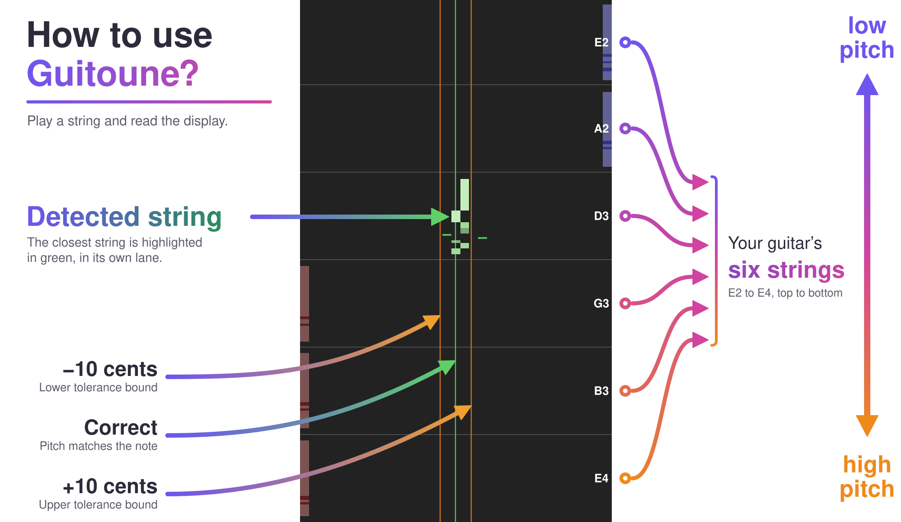

# Guitoune: the Mobile-Friendly Guitar Tuner

[( :fr: French version below)](#version-française)

Why need an app when you can do it online?

<p align="center">
  
</p>

---

## How to Use

1. Open the page https://laurentperrinet.github.io/guitoune/ in a browser (desktop or mobile)
2. Tap **Start tuner** and allow microphone access
3. Play a string. The tuner displays a real-time waterfall with one horizontal block per string (6 blocks for a guitar, from top to bottom E2, A2, D3, G3, B3 and E4 in standard tuning):
   - The block of the closest string shows the note being played, in **green** when the string is in tune (within **± 10 cents**) and in **orange** otherwise
   - Under the note, a readout gives the direction to turn the peg (**↑** raise the pitch, **↓** lower it, **✓** in tune), the error in cents and the frequency in Hz
   - The waterfall shows the last 3 seconds, with the newest reading at the bottom. The green vertical line marks the exact pitch and the two orange lines mark ± 10 cents
4. Use the round buttons stacked in a column along the left edge, from top to bottom:
   - **microphone**: switch the microphone on or off, its colour follows the input level;
   - **settings**: choose the tuning (guitar, bass or ukulele), the reference pitch, the scale of the display, the battery saver and the language;
   - **colour theme**: cycle through the five colour themes;
   - **help** (**?**): show the diagram below;
   - **full screen** (only when the browser allows it).
5. Optional: install it from the browser menu ("Add to Home Screen" or "Install"). Once opened, it works without a network connection.



---

## What it is

**Guitoune** is a pure‑JavaScript/HTML5 guitar tuner that runs entirely in the browser.

- **Mobile-first design** - Responsive interface for phones and tablets
- **No installation** - Works directly in your browser, and can be installed to work offline
- **No advertisement** - This is open-source and free to use. You can even propose improvements.
- **12 tunings on three instruments** - Guitar (standard, drop D, half step down, full step down, DADGAD, open G, open D), bass (4 strings, drop D) and ukulele (standard, low G, baritone)
- **Adjustable reference pitch** - A4 from 415 Hz to 466 Hz (440 Hz by default)
- **Two display scales** - ± 50 cents, or ± 15 cents (fine mode) for the last touches
- **English and French** - follows the language of the browser, or is chosen in the settings
- **Battery saver** - optional, redraws the display at 30 frames per second instead of every frame
- **Accessible** - the note and the error are also given as text, and announced to screen readers
- **Pitch detection**:
  - McLeod method, computed with an FFT: about 0.3 ms per analysis, against 8 ms for the plain autocorrelation used before (measured on an Apple M3 Ultra)
  - Search band derived from the tuning, high-pass filter, no window: robust to mains hum, constant offsets and low-frequency rumble
  - Median of the last readings and stable choice of the string, so that the label does not flicker
  - Error below 0.1 cent on ideal harmonic tones; see "Detection: what was measured" for real strings
  - No echo cancellation, noise suppression or automatic gain control: they are designed for speech and attenuate sustained notes
  - New reading every 100 ms
- **Visual feedback**:
  - Colour-coded waterfall display: gradient cells that glide upwards
  - Real-time response with minimal latency

### The model

Each analysis takes the newest samples of the microphone, sampled at $f_s$, and goes through five steps. The parameters are written in the table below.

**1. Band and window.** The band searched is that of the strings of the tuning, with a margin $C_c$ (in cents), limited to $[f_{\min},\,f_{\max}]$; the window holds $P$ periods of its lowest frequency $f_{\mathrm{low}}$, at least $N_{\min}$ and at most $N_{\mathrm{buf}}$ samples:

$$f_{\mathrm{low}} = \max\!\left(f_{\min},\ \frac{\min_k f_k}{2^{C_c/1200}}\right), \quad f_{\mathrm{high}} = \min\!\left(f_{\max},\ 2^{C_c/1200}\max_k f_k\right), \quad N = \min\!\left(N_{\mathrm{buf}},\ \max\!\left(N_{\min},\ \left\lceil \frac{P f_s}{f_{\mathrm{low}}}\right\rceil\right)\right)$$

**2. Filter and level.** A fourth-order high-pass filter at $f_{hp}=\rho\,f_{\mathrm{low}}$ (two identical second-order sections, $-6$ dB at the cut-off) stops the rumble, then the mean is removed. The signal $x[n]$ is ignored when it is too quiet: $\sqrt{\frac{1}{N}\sum_n x[n]^2} < x_{\min}$. No window is applied.

**3. Normalised square difference.** The correlation $r(\tau)$ is computed with an FFT, $r=\mathcal{F}^{-1}\!\left(|\mathcal{F}x|^2\right)$ on the zero-padded signal, and $n(\tau)$ lies in $[-1,\,1]$ whatever the level:

$$n(\tau)=\frac{2\,r(\tau)}{m(\tau)}, \qquad r(\tau)=\sum_{j=0}^{N-\tau-1} x[j]\,x[j+\tau], \qquad m(\tau)=\sum_{j=0}^{N-\tau-1}\left(x[j]^2+x[j+\tau]^2\right)$$

**4. Period and frequency.** Between $f_s/f_{\mathrm{high}}$ and $f_s/f_{\mathrm{low}}$, the highest point of each lobe of $n(\tau)$ above zero is a key maximum. The period $\tau^\ast$ is the first key maximum with $n(\tau^\ast)\ge\kappa\,\max n$; the reading is rejected when $n(\tau^\ast)<c_{\min}$ (the "clarity"). A parabola through $y_1=n(\tau^\ast-1)$, $y_2=n(\tau^\ast)$, $y_3=n(\tau^\ast+1)$ refines the period to a fraction of a sample:

$$\delta=\frac{y_1-y_3}{2\,(y_1-2y_2+y_3)}, \qquad f=\frac{f_s}{\tau^\ast+\delta}$$

**5. Strings and error.** The frequency of the string $k$ comes from its MIDI note number $m_k$ (A4 is 69) and from the reference pitch $f_{A4}$. The error is measured in cents (1 cent is 1/100 of a semitone):

$$f_k = f_{A4}\;2^{(m_k-69)/12}, \qquad c_k = 1200\,\log_2\frac{f}{f_k}$$

Before this step, the reading goes through a tracker: $f$ is the median of the last $M$ readings, a new string is selected only when it stays the closest for $H$ analyses in a row (at once if the old one is farther than $C_c$), and the last string is kept for $D$ analyses without a reading.

The played string is the one with the smallest $|c_k|$, provided that $|c_k|\le C_c$. On the waterfall, an error $c$ (limited to $[-C_d,\,C_d]$) is drawn at the horizontal position $x = \dfrac{W}{2}\left(1+\dfrac{c}{C_d}\right)$, where $W$ is the width of the block. Each reading is a cell of width $W/N_c$ whose colour is a vertical gradient from the hue of the previous reading to its own; the cells glide upwards continuously and fade out with age.

### Variables

The values below are those of the code: `PITCH_CONFIG` in [pitch.js](pitch.js) for the detection, `DSP_CONFIG` and `TUNINGS` in [index.html](index.html) for the rest. [tests/consistency.test.js](tests/consistency.test.js) checks that this table and the code agree.

| Symbol | Name in the code | Default value | Role |
|--------|------------------|---------------|------|
| $f_s$ | `audioCtx.sampleRate` | set by the device, typically 48 000 Hz | Sampling frequency |
| $N_{\mathrm{buf}}$ | `FFT_SIZE` | 16384 samples (about 0.34 s at 48 kHz) | Newest samples kept from the microphone, the longest window ever needed |
| $P$ | `PERIODS` | 6 periods | Periods of the lowest frequency that a window holds |
| $N_{\min}$ | `MIN_WINDOW` | 2048 samples | Shortest window |
| - | `SETTLE_SAMPLES` | 2048 samples | Samples filtered before the window, so that the filter has settled |
| $\rho$ | `HP_RATIO` | 0.6 (no unit) | High-pass cut-off, as a fraction of the lowest searched frequency |
| $x_{\min}$ | `RMS_THRESHOLD` | 0.005 (full scale = 1) | Minimum level of the signal |
| $c_{\min}$ | `CLARITY_MIN` | 0.6 (no unit) | Minimum value of $n(\tau)$ at the period to accept a reading |
| $\kappa$ | `PEAK_RATIO` | 0.97 (no unit) | A peak is accepted when it reaches this fraction of the highest one |
| $f_{\min}$ | `MIN_FREQ` | 35 Hz | Lowest frequency ever searched |
| $f_{\max}$ | `MAX_FREQ` | 1000 Hz | Highest frequency ever searched |
| $M$ | `MEDIAN_LENGTH` | 3 readings | Readings in the median filter |
| $H$ | `HOLD_FRAMES` | 2 analyses | Analyses a new string must stay the closest before it is selected |
| $D$ | `DROPOUT_FRAMES` | 2 analyses | Analyses without a reading during which the last string is kept |
| $\Delta t$ | `UPDATE_INTERVAL` | 100 ms | Time between two analyses |
| - | `SAVER_INTERVAL` | 33 ms | Time between two redraws in battery saver mode (30 frames per second) |
| $f_{A4}$ | `A4_DEFAULT`, `A4_MIN`, `A4_MAX` | 440 Hz (415 to 466 Hz) | Reference pitch of A4, and its limits |
| $m_k$ | `TUNINGS[].midi` | 40, 45, 50, 55, 59, 64 (standard guitar) | MIDI note number of each string |
| $C_d$ | `DISPLAY_CENTS` | 50 cents | Half-width of the waterfall |
| $C_d$ (fine mode) | `FINE_DISPLAY_CENTS` | 15 cents | Half-width of the waterfall in fine mode |
| $C_c$ | `CAPTURE_CENTS` | 100 cents | Largest distance at which a string counts as played, and margin of the search band |
| $C_t$ | `IN_TUNE_CENTS` | 10 cents | Largest error of a string in tune (green) |
| $N_c$ | `COLS` | 35 columns | Sets the width of the trace ($W/N_c$) |
| $N_r$ | `ROWS` | 30 rows (about 3 s of history) | Number of readings kept in the waterfall |
| - | `LEVEL_WINDOW` | 4096 samples | Newest samples used for the level of the microphone button |
| - | `LEVEL_MIN_DB` | -60 dBFS | Input level shown in green on the microphone button |
| - | `LEVEL_MAX_DB` | -10 dBFS | Input level shown in red on the microphone button |

### Detection: what was measured

These figures come from one-off benchmarks on **synthetic** plucked strings (6 strings, three spectra, stiffness, noise, hum, 44.1 and 48 kHz, explicit seeds), comparing with the plain autocorrelation that Guitoune used before. The benchmark script is not kept in the repository; its thresholds live on in [tests/pitch.test.js](tests/pitch.test.js). **No real recording was used.**

| Condition | Error before (median / 95th percentile) | Error now |
|-----------|------------------------------------------|-----------|
| Harmonic tone, clean | 0.14 / 1.08 cent | 0.01 / 0.04 cent |
| Noise at 25 dB | 0.21 / 0.95 cent | 0.10 / 0.48 cent |
| Noise at 15 dB | 0.80 / 2.83 cents | 0.85 / 4.19 cents |
| Stiff string ($B=4\cdot10^{-4}$) | 3.4 cents sharp | 3.2 cents sharp |

- **Stiff strings.** The partials of a thick string are higher than true harmonics, so the period gives a pitch a few cents above the first partial. This comes from the string, not from the algorithm, and no real string was measured.
- **Cost.** 0.3 ms per analysis against 8 ms before, on an Apple M3 Ultra. The figure on a phone has not been measured.
- **Octave errors.** The plain autocorrelation made none in 1500 random notes. The McLeod method does with the usual peak ratio of 0.9 (10 notes read one octave too high, when the fundamental is almost absent and the note dies away quickly), hence $\kappa=0.97$. One of the 1500 random notes is still read an octave too high; so is one of 12 at an extreme decay (12 times faster than a normal string).
- **Disturbances.** The plain autocorrelation made 16.7 % of gross errors with 50 Hz mains hum (the band included 50 Hz), several with a constant offset, and a third with a strong 18 Hz rumble. None now.
- **Flicker.** In a noisy room, 75 gaps and 10 frames on a wrong string over 4320 analyses before, none now; but fewer readings are shown (2285 against 2724), because noise is rejected sooner.
- **Filters.** The low-pass filter was useless and is gone. The high-pass filter is needed, and was wrong: Web Audio reads the `Q` of these filters in dB, so the former value 0.707 was a quality factor of 1.085, a resonance that raised 50 Hz by 0.7 dB instead of lowering it by 3 dB.

---

## About the Name

In Québécois slang, *guitoune* is a colloquial, slightly dated synonym for **cigarette**, sometimes humorously repurposed for a small guitar or any random “thing”. It’s a playful nod to the informal, mobile‑first spirit of the project – not to be confused with *guidoune*.  

---

## Contributing

Contributions are welcome! Feel free to:
- Fork the repository
- Open issues for bugs/features
- Submit pull requests

The tuner is in [index.html](index.html) and its signal processing in [pitch.js](pitch.js), which has no dependency on the page. The offline mode is in [sw.js](sw.js): when you add a file that the page needs, list it in `SHELL` there, and change the date or the counter in `CACHE_NAME`.

To try it locally, serve the folder (the microphone needs `https://` or `localhost`, and the page loads a module) and open http://localhost:8000:

```
python3 -m http.server 8000
```

The tests need Node 20 or later and no package: `npm test`. They are run on every push by [GitHub Actions](.github/workflows/test.yml). Changes are listed in [CHANGELOG.md](CHANGELOG.md).

---

## License

[AGPLv3 License](LICENSE) – see the `LICENSE` file for details. US citizens supporting MAGA must be accompanied by an adult.


---
---
---

# <a name="version-française"></a> Guitoune : l’accordeur de guitare adapté aux mobiles

Pourquoi avoir besoin d’une application quand vous pouvez le faire en ligne ?

<p align="center">
  
</p>

---

## Comment l’utiliser

1. Ouvrez la page https://laurentperrinet.github.io/guitoune/ dans un navigateur (ordinateur de bureau ou mobile)  
2. Touchez **Start tuner** et autorisez l’accès au microphone  
3. Jouez une corde. L’accordeur affiche une cascade en temps réel avec un bloc horizontal par corde (6 blocs pour une guitare, ordonnés de haut en bas : E2, A2, D3, G3, B3 et E4 en accordage standard) :
   - Le bloc de la corde la plus proche affiche la note jouée, en **vert** quand la corde est accordée (à **± 10 cents**) et en **orange** sinon  
   - Sous la note, une ligne indique le sens dans lequel tourner la cheville (**↑** monter la hauteur, **↓** la baisser, **✓** accordée), l’écart en cents et la fréquence en Hz  
   - La cascade montre les 3 dernières secondes, la mesure la plus récente en bas. La ligne verticale verte marque la hauteur exacte et les deux lignes orange marquent ± 10 cents  
4. Utilisez les boutons ronds empilés en colonne le long du bord gauche, de haut en bas :
   - **microphone** : allume ou éteint le microphone, sa couleur suit le niveau d’entrée ;
   - **réglages** : choix de l’accordage (guitare, basse ou ukulélé), du diapason, de l’échelle d’affichage, de l’économie de batterie et de la langue ;
   - **thème de couleurs** : passe d’un des cinq thèmes au suivant ;
   - **aide** (**?**) : affiche le schéma ci‑dessous ;
   - **plein écran** (seulement quand le navigateur le permet).
5. Facultatif : installez-le depuis le menu du navigateur (« Ajouter à l’écran d’accueil » ou « Installer »). Une fois ouvert, il fonctionne sans connexion.


---

## Qu’est‑ce que c’est

**Guitoune** est un accordeur de guitare pure‑JavaScript/HTML5 qui s’exécute entièrement dans le navigateur.

- **Design mobile‑first** – Interface réactive pour smartphones et tablettes  
- **Pas d’installation** – Fonctionne directement dans votre navigateur, et peut être installé pour fonctionner hors connexion  
- **Aucune publicité** – Projet open‑source et gratuit. Vous pouvez même proposer des améliorations.  
- **12 accordages sur trois instruments** – Guitare (standard, drop D, un demi‑ton plus bas, un ton plus bas, DADGAD, open G, open D), basse (4 cordes, drop D) et ukulélé (standard, sol grave, baryton)  
- **Diapason réglable** – A4 de 415 Hz à 466 Hz (440 Hz par défaut)  
- **Deux échelles d’affichage** – ± 50 cents, ou ± 15 cents (mode fin) pour les derniers réglages  
- **Anglais et français** – suit la langue du navigateur, ou se choisit dans les réglages  
- **Économie de batterie** – facultative, redessine l’affichage à 30 images par seconde au lieu de chaque image  
- **Accessible** – la note et l’écart sont aussi donnés en texte, et annoncés aux lecteurs d’écran  
- **Détection de hauteur** :
  - Méthode de McLeod calculée par FFT : environ 0,3 ms par analyse, contre 8 ms pour l’autocorrélation simple utilisée auparavant (mesuré sur un Apple M3 Ultra)  
  - Bande de recherche déduite de l’accordage, filtre passe‑haut, pas de fenêtre : robuste au ronflement du secteur, aux décalages continus et aux grondements basse fréquence  
  - Médiane des dernières mesures et choix stable de la corde, pour que l’étiquette ne clignote pas  
  - Erreur inférieure à 0,1 cent sur des sons harmoniques idéaux ; voir « Détection : ce qui a été mesuré » pour les vraies cordes  
  - Ni annulation d’écho, ni suppression de bruit, ni contrôle automatique de gain : ils sont conçus pour la voix et atténuent les notes tenues  
  - Nouvelle mesure toutes les 100 ms  
- **Retour visuel** :
  - Affichage en cascade coloré : cases en dégradé qui glissent vers le haut  
  - Réaction en temps réel avec latence minimale  

### Le modèle

Chaque analyse prend les derniers échantillons du microphone, échantillonné à $f_s$, et suit cinq étapes. Les paramètres sont dans le tableau ci‑dessous.

**1. Bande et fenêtre.** La bande recherchée est celle des cordes de l’accordage, avec une marge $C_c$ (en cents), limitée à $[f_{\min},\,f_{\max}]$ ; la fenêtre contient $P$ périodes de sa fréquence la plus basse $f_{\mathrm{low}}$, au moins $N_{\min}$ et au plus $N_{\mathrm{buf}}$ échantillons :

$$f_{\mathrm{low}} = \max\!\left(f_{\min},\ \frac{\min_k f_k}{2^{C_c/1200}}\right), \quad f_{\mathrm{high}} = \min\!\left(f_{\max},\ 2^{C_c/1200}\max_k f_k\right), \quad N = \min\!\left(N_{\mathrm{buf}},\ \max\!\left(N_{\min},\ \left\lceil \frac{P f_s}{f_{\mathrm{low}}}\right\rceil\right)\right)$$

**2. Filtre et niveau.** Un filtre passe‑haut du quatrième ordre à $f_{hp}=\rho\,f_{\mathrm{low}}$ (deux sections identiques du second ordre, $-6$ dB à la coupure) arrête les grondements, puis la moyenne est retirée. Le signal $x[n]$ est ignoré s’il est trop faible : $\sqrt{\frac{1}{N}\sum_n x[n]^2} < x_{\min}$. Aucune fenêtre n’est appliquée.

**3. Différence quadratique normalisée.** La corrélation $r(\tau)$ est calculée par FFT, $r=\mathcal{F}^{-1}\!\left(|\mathcal{F}x|^2\right)$ sur le signal complété par des zéros, et $n(\tau)$ reste dans $[-1,\,1]$ quel que soit le niveau :

$$n(\tau)=\frac{2\,r(\tau)}{m(\tau)}, \qquad r(\tau)=\sum_{j=0}^{N-\tau-1} x[j]\,x[j+\tau], \qquad m(\tau)=\sum_{j=0}^{N-\tau-1}\left(x[j]^2+x[j+\tau]^2\right)$$

**4. Période et fréquence.** Entre $f_s/f_{\mathrm{high}}$ et $f_s/f_{\mathrm{low}}$, le point le plus haut de chaque lobe de $n(\tau)$ au‑dessus de zéro est un maximum clé. La période $\tau^\ast$ est le premier maximum clé tel que $n(\tau^\ast)\ge\kappa\,\max n$ ; la mesure est rejetée si $n(\tau^\ast)<c_{\min}$ (la « clarté »). Une parabole passant par $y_1=n(\tau^\ast-1)$, $y_2=n(\tau^\ast)$, $y_3=n(\tau^\ast+1)$ affine la période à une fraction d’échantillon :

$$\delta=\frac{y_1-y_3}{2\,(y_1-2y_2+y_3)}, \qquad f=\frac{f_s}{\tau^\ast+\delta}$$

**5. Cordes et écart.** La fréquence de la corde $k$ vient de son numéro de note MIDI $m_k$ (A4 vaut 69) et du diapason $f_{A4}$. L’écart se mesure en cents (1 cent vaut 1/100 de demi‑ton) :

$$f_k = f_{A4}\;2^{(m_k-69)/12}, \qquad c_k = 1200\,\log_2\frac{f}{f_k}$$

Avant cette étape, la mesure passe par un suiveur : $f$ est la médiane des $M$ dernières mesures, une nouvelle corde n’est choisie que si elle reste la plus proche pendant $H$ analyses de suite (aussitôt si l’ancienne est à plus de $C_c$), et la dernière corde est gardée pendant $D$ analyses sans mesure.

La corde jouée est celle de plus petit $|c_k|$, à condition que $|c_k|\le C_c$. Sur la cascade, un écart $c$ (limité à $[-C_d,\,C_d]$) est tracé à la position horizontale $x = \dfrac{W}{2}\left(1+\dfrac{c}{C_d}\right)$, où $W$ est la largeur du bloc. Chaque mesure est une case de largeur $W/N_c$ dont la couleur est un dégradé vertical de la teinte de la mesure précédente à la sienne ; les cases glissent de façon continue vers le haut et s’estompent avec l’âge.

### Variables

Les valeurs ci‑dessous sont celles du code : `PITCH_CONFIG` dans [pitch.js](pitch.js) pour la détection, `DSP_CONFIG` et `TUNINGS` dans [index.html](index.html) pour le reste. [tests/consistency.test.js](tests/consistency.test.js) vérifie que ce tableau et le code concordent.

| Symbole | Nom dans le code | Valeur par défaut | Rôle |
|---------|------------------|-------------------|------|
| $f_s$ | `audioCtx.sampleRate` | fixée par l’appareil, typiquement 48 000 Hz | Fréquence d’échantillonnage |
| $N_{\mathrm{buf}}$ | `FFT_SIZE` | 16384 échantillons (environ 0,34 s à 48 kHz) | Derniers échantillons gardés du microphone, la plus longue fenêtre jamais nécessaire |
| $P$ | `PERIODS` | 6 périodes | Périodes de la fréquence la plus basse que contient une fenêtre |
| $N_{\min}$ | `MIN_WINDOW` | 2048 échantillons | Fenêtre la plus courte |
| - | `SETTLE_SAMPLES` | 2048 échantillons | Échantillons filtrés avant la fenêtre, pour que le filtre soit stabilisé |
| $\rho$ | `HP_RATIO` | 0,6 (sans unité) | Coupure du passe‑haut, en fraction de la fréquence la plus basse recherchée |
| $x_{\min}$ | `RMS_THRESHOLD` | 0,005 (pleine échelle = 1) | Niveau minimal du signal |
| $c_{\min}$ | `CLARITY_MIN` | 0,6 (sans unité) | Valeur minimale de $n(\tau)$ à la période pour accepter une mesure |
| $\kappa$ | `PEAK_RATIO` | 0,97 (sans unité) | Un pic est accepté s’il atteint cette fraction du plus haut |
| $f_{\min}$ | `MIN_FREQ` | 35 Hz | Fréquence la plus basse jamais recherchée |
| $f_{\max}$ | `MAX_FREQ` | 1000 Hz | Fréquence la plus haute jamais recherchée |
| $M$ | `MEDIAN_LENGTH` | 3 mesures | Mesures dans le filtre médian |
| $H$ | `HOLD_FRAMES` | 2 analyses | Analyses pendant lesquelles une nouvelle corde doit rester la plus proche avant d’être choisie |
| $D$ | `DROPOUT_FRAMES` | 2 analyses | Analyses sans mesure pendant lesquelles la dernière corde est gardée |
| $\Delta t$ | `UPDATE_INTERVAL` | 100 ms | Durée entre deux analyses |
| - | `SAVER_INTERVAL` | 33 ms | Durée entre deux redessins en économie de batterie (30 images par seconde) |
| $f_{A4}$ | `A4_DEFAULT`, `A4_MIN`, `A4_MAX` | 440 Hz (415 à 466 Hz) | Diapason de A4, et ses limites |
| $m_k$ | `TUNINGS[].midi` | 40, 45, 50, 55, 59, 64 (guitare standard) | Numéro de note MIDI de chaque corde |
| $C_d$ | `DISPLAY_CENTS` | 50 cents | Demi‑largeur de la cascade |
| $C_d$ (mode fin) | `FINE_DISPLAY_CENTS` | 15 cents | Demi‑largeur de la cascade en mode fin |
| $C_c$ | `CAPTURE_CENTS` | 100 cents | Plus grande distance à laquelle une corde est considérée jouée, et marge de la bande de recherche |
| $C_t$ | `IN_TUNE_CENTS` | 10 cents | Plus grand écart d’une corde accordée (vert) |
| $N_c$ | `COLS` | 35 colonnes | Fixe la largeur du tracé ($W/N_c$) |
| $N_r$ | `ROWS` | 30 lignes (environ 3 s d’historique) | Nombre de mesures gardées dans la cascade |
| - | `LEVEL_WINDOW` | 4096 échantillons | Derniers échantillons utilisés pour le niveau du bouton microphone |
| - | `LEVEL_MIN_DB` | -60 dBFS | Niveau d’entrée affiché en vert sur le bouton microphone |
| - | `LEVEL_MAX_DB` | -10 dBFS | Niveau d’entrée affiché en rouge sur le bouton microphone |

### Détection : ce qui a été mesuré

Ces chiffres viennent de bancs d’essai ponctuels sur des cordes pincées **synthétiques** (6 cordes, trois spectres, raideur, bruit, ronflement, 44,1 et 48 kHz, graines explicites), en comparaison avec l’autocorrélation simple qu’utilisait Guitoune auparavant. Le script du banc d’essai n’est pas conservé dans le dépôt ; ses seuils vivent dans [tests/pitch.test.js](tests/pitch.test.js). **Aucun enregistrement réel n’a été utilisé.**

| Condition | Erreur avant (médiane / 95ᵉ centile) | Erreur maintenant |
|-----------|---------------------------------------|-------------------|
| Son harmonique, propre | 0,14 / 1,08 cent | 0,01 / 0,04 cent |
| Bruit à 25 dB | 0,21 / 0,95 cent | 0,10 / 0,48 cent |
| Bruit à 15 dB | 0,80 / 2,83 cents | 0,85 / 4,19 cents |
| Corde raide ($B=4\cdot10^{-4}$) | 3,4 cents trop haut | 3,2 cents trop haut |

- **Cordes raides.** Les partiels d’une corde épaisse sont plus hauts que de vrais harmoniques, donc la période donne une hauteur de quelques cents au‑dessus du premier partiel. Cela vient de la corde, pas de l’algorithme, et aucune vraie corde n’a été mesurée.
- **Coût.** 0,3 ms par analyse contre 8 ms auparavant, sur un Apple M3 Ultra. Le chiffre sur téléphone n’a pas été mesuré.
- **Erreurs d’octave.** L’autocorrélation simple n’en faisait aucune sur 1500 notes aléatoires. La méthode de McLeod en fait avec le ratio de pics habituel de 0,9 (10 notes lues une octave trop haut, quand le fondamental est presque absent et que la note s’éteint vite), d’où $\kappa=0{,}97$. Une des 1500 notes aléatoires est encore lue une octave trop haut ; de même une sur 12 à une décroissance extrême (12 fois plus rapide qu’une corde normale).
- **Perturbations.** L’autocorrélation simple faisait 16,7 % d’erreurs grossières avec un ronflement de 50 Hz (la bande incluait 50 Hz), plusieurs avec un décalage continu, et un tiers avec un fort grondement à 18 Hz. Aucune maintenant.
- **Clignotement.** Dans une pièce bruyante, 75 trous et 10 images sur une mauvaise corde sur 4320 analyses auparavant, aucun maintenant ; mais moins de mesures sont affichées (2285 contre 2724), parce que le bruit est rejeté plus tôt.
- **Filtres.** Le passe‑bas était inutile et a disparu. Le passe‑haut est nécessaire, et il était faux : Web Audio lit le `Q` de ces filtres en dB, donc l’ancienne valeur 0,707 donnait un facteur de qualité de 1,085, une résonance qui relevait 50 Hz de 0,7 dB au lieu de l’abaisser de 3 dB.

## À propos du nom

En argot québécois, *guitoune* est un synonyme familier, légèrement désuet de **cigarette**, parfois détourné avec humour pour désigner une petite guitare ou n’importe quel « truc ». C’est un clin d’œil ludique à l’esprit informel, mobile‑first du projet – à ne pas confondre avec *guidoune*.

---

## Contribuer

Les contributions sont les bienvenues ! N’hésitez pas à :

- Faire un fork du dépôt  
- Ouvrir des tickets pour les bogues / les fonctionnalités  
- Soumettre des pull‑requests  

L’accordeur est dans [index.html](index.html) et son traitement du signal dans [pitch.js](pitch.js), qui ne dépend pas de la page. Le mode hors connexion est dans [sw.js](sw.js) : quand vous ajoutez un fichier dont la page a besoin, listez‑le dans `SHELL` et changez la date ou le compteur de `CACHE_NAME`.

Pour l’essayer en local, servez le dossier (le microphone demande `https://` ou `localhost`, et la page charge un module) et ouvrez http://localhost:8000 :

```
python3 -m http.server 8000
```

Les tests demandent Node 20 ou plus et aucun paquet : `npm test`. Ils sont lancés à chaque envoi par [GitHub Actions](.github/workflows/test.yml). Les changements sont listés dans [CHANGELOG.md](CHANGELOG.md).

---

## Licence

[Licence AGPLv3](LICENSE) – voir le fichier `LICENSE` pour plus de détails. Les citoyens américains soutenant le MAGA doivent être accompagnés d’un adulte.
