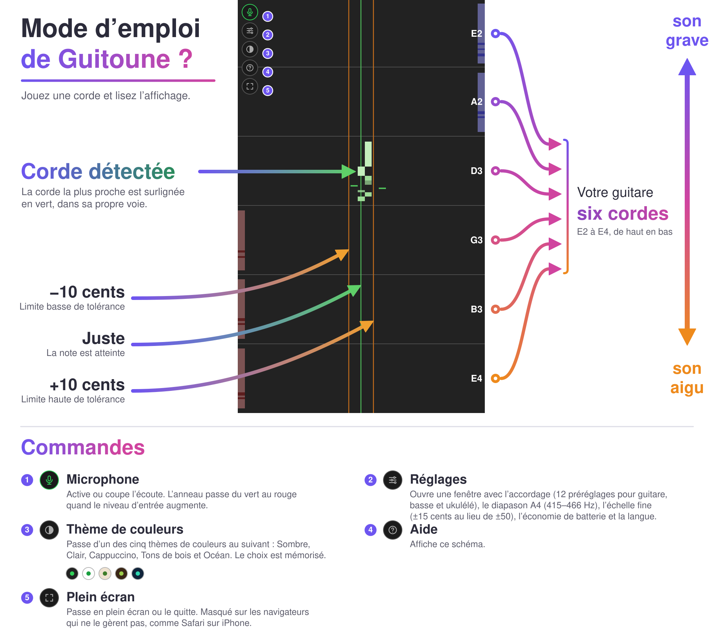
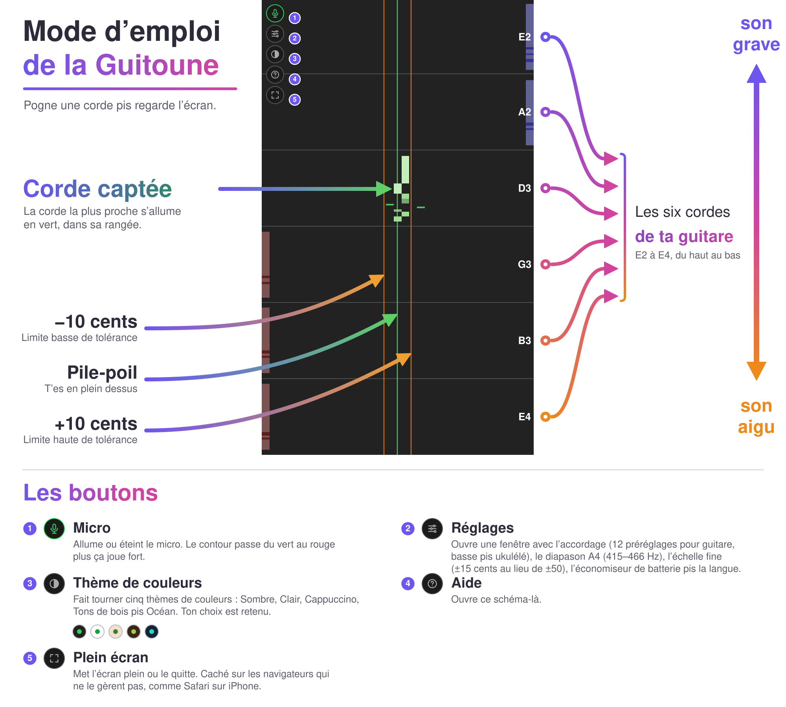

# <a name="english-version"></a> Guitoune: the Mobile-Friendly Guitar Tuner

<p align="center">
  <a href="#english-version">🇬🇧 English</a> ·
  <a href="#version-française">🇫🇷 Français</a> ·
  <a href="#version-québécoise">⚜️ Québécois</a>
</p>

Why need an app when you can do it online?

<p align="center">
  
</p>

---

## How to Use

1. Open the page https://laurentperrinet.github.io/guitoune/ in a browser (desktop or mobile)
2. Tap **Start tuner** and allow microphone access
3. Play a string. The tuner displays a real-time waterfall with one horizontal block per string (6 blocks for a guitar, from top to bottom E2, A2, D3, G3, B3 and E4 in standard tuning):
   - The block of the closest string shows the note being played, in **green** when the string is in tune (within **± 10 cents**) and in **orange** otherwise
   - Under the note, a readout gives the direction to turn the peg (**↑** raise the pitch, **↓** lower it, **✓** in tune), the error in cents and the frequency in Hz
   - The waterfall shows the last 3 seconds, with the newest reading at the bottom. The green vertical line marks the exact pitch and the two orange lines mark ± 10 cents
4. Use the round buttons stacked in a column along the left edge, from top to bottom:
   - **microphone**: switch the microphone on or off, its colour follows the input level;
   - **settings**: choose the tuning (guitar, bass or ukulele), the reference pitch, the scale of the display, the battery saver and the language;
   - **colour theme**: cycle through the five colour themes;
   - **language** (a flag): cycle through French, English and Québécois;
   - **help** (**?**): show the diagram below;
   - **full screen** (only when the browser allows it).
5. Optional: install it from the browser menu ("Add to Home Screen" or "Install"). Once opened, it works without a network connection.


---

## What it is

**Guitoune** is a pure‑JavaScript/HTML5 guitar tuner that runs entirely in the browser.

- **Mobile-first design** - Responsive interface for phones and tablets
- **No installation** - Works directly in your browser, and can be installed to work offline
- **No advertisement** - This is open-source and free to use. You can even propose improvements.
- **12 tunings on three instruments** - Guitar (standard, drop D, half step down, full step down, DADGAD, open G, open D), bass (4 strings, drop D) and ukulele (standard, low G, baritone)
- **Adjustable reference pitch** - A4 from 415 Hz to 466 Hz (440 Hz by default)
- **Two display scales** - ± 50 cents, or ± 15 cents (fine mode) for the last touches
- **English, French and Québécois** - French by default; the flag button (or the settings) cycles through the three, and the last choice is kept, like the colour theme and the tuning; `?lang=en`, `?lang=fr` or `?lang=qc` at the end of the address forces one until the next choice. The diagram of the help button is translated too
- **Battery saver** - optional, redraws the display at 30 frames per second instead of every frame
- **Accessible** - the note and the error are also given as text, and announced to screen readers
- **Pitch detection**:
  - McLeod method computed with an FFT: about 0.3 ms per analysis on an Apple M3 Ultra, a new reading every 50 ms
  - Search band derived from the tuning, high-pass and low-pass filters, no window: robust to mains hum, constant offsets, broadband noise, the click of the attack and low-frequency rumble
  - Sensitivity relative to the noise floor of the room: a soft note is read in a quiet room, and a steady hum or fan is never taken for a note
  - Spike filter and stable choice of the string, so that the label does not flicker
  - Error at most 0.2 cent on ideal harmonic tones of a guitar (0.6 cent for the E1 of a bass); measured on synthetic strings only, see the [CHANGELOG](CHANGELOG.md)
  - No echo cancellation, noise suppression or automatic gain control: they attenuate sustained notes
- **Visual feedback**:
  - Colour-coded waterfall display: gradient cells that glide upwards
  - Margins on each side of a row show the energy near the other strings (lower on the left, higher on the right), so that the string detected stands out; its own row has none; they keep moving in a quiet room and breathe slowly while the microphone is off
  - Real-time response with minimal latency

### The model

Each analysis takes the newest samples of the microphone, sampled at $f_s$, and goes through six steps. The parameters are written in the table below.

**1. Band and window.** The band searched is that of the strings of the tuning, with a margin $C_c$ (in cents), limited to $[f_{\min},\,f_{\max}]$; the window holds $P$ periods of its lowest frequency $f_{\mathrm{low}}$, at least $N_{\min}$ and at most $N_{\mathrm{buf}}$ samples:

$$f_{\mathrm{low}} = \max\!\left(f_{\min},\ \frac{\min_k f_k}{2^{C_c/1200}}\right), \quad f_{\mathrm{high}} = \min\!\left(f_{\max},\ 2^{C_c/1200}\max_k f_k\right), \quad N = \min\!\left(N_{\mathrm{buf}},\ \max\!\left(N_{\min},\ \left\lceil \frac{P f_s}{f_{\mathrm{low}}}\right\rceil\right)\right)$$

**2. Filters and level.** A fourth-order high-pass filter at $f_{hp}=\rho\,f_{\mathrm{low}}$ (two identical second-order sections, $-6$ dB at the cut-off) stops the rumble, and a second-order low-pass filter at $f_{lp}=\lambda\,f_{\mathrm{high}}$ ($-3$ dB at the cut-off) removes the broadband noise and the click of the attack of the string. Then the mean is removed. The level of the window, $\sqrt{\frac{1}{N}\sum_n x[n]^2}$, must exceed $\max(g_{\min},\ \gamma\,\ell)$, where $\ell$ is the noise floor of the room: the lowest level seen, followed down at once and up at $v_g$ dB per second, or at $v_s$ dB per second when the level has stayed within $\Delta_s$ dB for $T_s$ seconds (a hum, not a note); before the first level is measured, the threshold is $x_{\min}$. No window is applied.

**3. Normalised square difference.** The correlation $r(\tau)$ is computed with an FFT, $r=\mathcal{F}^{-1}\!\left(|\mathcal{F}x|^2\right)$ on the zero-padded signal, and $n(\tau)$ lies in $[-1,\,1]$ whatever the level:

$$n(\tau)=\frac{2\,r(\tau)}{m(\tau)}, \qquad r(\tau)=\sum_{j=0}^{N-\tau-1} x[j]\,x[j+\tau], \qquad m(\tau)=\sum_{j=0}^{N-\tau-1}\left(x[j]^2+x[j+\tau]^2\right)$$

**4. Period and frequency.** Between $f_s/f_{\mathrm{high}}$ and $f_s/f_{\mathrm{low}}$, the highest point of each lobe of $n(\tau)$ above zero is a key maximum. The period $\tau^\ast$ is the first key maximum with $n(\tau^\ast)\ge\kappa\,\max n$. A parabola through $y_1=n(\tau^\ast-1)$, $y_2=n(\tau^\ast)$, $y_3=n(\tau^\ast+1)$ refines the period to a fraction of a sample:

$$\delta=\frac{y_1-y_3}{2\,(y_1-2y_2+y_3)}, \qquad f=\frac{f_s}{\tau^\ast+\delta}$$

The reading is rejected when its "clarity", the height of the parabola at its vertex $y_2-\tfrac{1}{4}(y_1-y_3)\,\delta$, is below $c_{\min}$.

**5. Strings and error.** The frequency of the string $k$ comes from its MIDI note number $m_k$ (A4 is 69) and from the reference pitch $f_{A4}$. The error is measured in cents (1 cent is 1/100 of a semitone):

$$f_k = f_{A4}\;2^{(m_k-69)/12}, \qquad c_k = 1200\,\log_2\frac{f}{f_k}$$

Before this step, the reading goes through a tracker: $f$ is the latest reading, unless it is farther than $C_s$ from the median of the last $M$ readings, which is then used instead (a spike filter); a new string is selected only when it stays the closest for $H$ analyses in a row (at once if the old one is farther than $C_c$), and the last string is kept for $D$ analyses without a reading. A reading whose clarity is at least $c_b$ is never replaced: it is a new note, not a spike.

The played string is the one with the smallest $|c_k|$, provided that $|c_k|\le C_c$. On the waterfall, an error $c$ (limited to $[-C_d,\,C_d]$) is drawn at the horizontal position $x = \dfrac{W}{2}\left(1+\dfrac{c}{C_d}\right)$, where $W$ is the width of the block. Each reading is a cell of width $W/N_c$ whose colour is a vertical gradient from the hue of the previous reading to its own; the cells glide upwards continuously and fade out with age.

**6. Margins.** For each string $k$, the energy near its frequency is found on the spectrum of the newest $N_a$ samples, windowed (Blackman-Harris) and transformed, where $N_a$ is the smallest power of two that puts the two closest strings $B_a$ bins apart, at most $N_{\mathrm{buf}}$. The level is the highest one in the band $[f_k\,2^{-C_a/1200},\ f_k\,2^{C_a/1200}]$, in dB relative to a sine of amplitude 1:

$$L_k = 20\,\log_{10}\frac{2\,\max_{f\,\in\,\mathrm{band}}|X(f)|}{\sum_n w[n]}$$

Each string has a noise floor $\ell_k$ that follows $L_k$ down at once and up at $v$ dB per second, so that a quiet room still makes the margins move and a note that is held fades out. The activity is $a_k=\min\!\left(1,\ \max\!\left(0,\ (L_k-\ell_k)/S\right)\right)$, and a column of the margin is drawn for each analysis with the opacity $a_{\min}+(1-a_{\min})\,a_k$. While the microphone is off, $a_k$ is a slow wave, $a_k=\frac{D}{2}\left(1+\sin\!\left(\frac{2\pi t}{T}-\frac{2\pi k}{K}\right)\right)$, which runs from the lowest string to the highest one ($K$ strings, period $T$, depth $D$) and stops when the system asks to reduce motion. The strips of the row of the string detected fade out, and come back when the note stops, at `STRIP_FADE_RATE` per second.

### Variables

The values below are those of the code: `PITCH_CONFIG` in [pitch.js](pitch.js) for the detection, `DSP_CONFIG` and `TUNINGS` in [index.html](index.html) for the rest. [tests/consistency.test.js](tests/consistency.test.js) checks that this table and the code agree.

| Symbol | Name in the code | Default value | Role |
|--------|------------------|---------------|------|
| $f_s$ | `audioCtx.sampleRate` | set by the device, typically 48 000 Hz | Sampling frequency |
| $N_{\mathrm{buf}}$ | `FFT_SIZE` | 16384 samples (about 0.34 s at 48 kHz) | Newest samples kept from the microphone, the longest window ever needed |
| $P$ | `PERIODS` | 6 periods | Periods of the lowest frequency that a window holds |
| $N_{\min}$ | `MIN_WINDOW` | 2048 samples | Shortest window |
| - | `SETTLE_SAMPLES` | 2048 samples | Samples filtered before the window, so that the filter has settled |
| $\rho$ | `HP_RATIO` | 0.6 (no unit) | High-pass cut-off, as a fraction of the lowest searched frequency |
| $\lambda$ | `LP_RATIO` | 3 (no unit) | Low-pass cut-off, as a multiple of the highest searched frequency |
| $x_{\min}$ | `RMS_THRESHOLD` | 0.005 (full scale = 1) | Level that a signal must reach while the noise floor is not known yet |
| $\gamma$ | `GATE_RATIO` | 3 (no unit) | A signal must exceed the noise floor of the room by this factor to be analysed |
| $g_{\min}$ | `GATE_MIN_RMS` | 0.0003 (full scale = 1) | Lowest level ever analysed |
| $v_g$ | `GATE_RISE_DB` | 0.5 dB per second | Speed at which the noise floor rises towards a level that is not steady |
| $T_s$ | `GATE_STEADY_SECONDS` | 2 s | A level is steady when it stays within `GATE_STEADY_DB` for this long |
| $\Delta_s$ | `GATE_STEADY_DB` | 2 dB | Spread of a steady level |
| $v_s$ | `GATE_STEADY_RISE_DB` | 6 dB per second | Speed at which the noise floor rises towards a steady level |
| $c_{\min}$ | `CLARITY_MIN` | 0.8 (no unit) | Minimum value of $n(\tau)$ at the period to accept a reading |
| $\kappa$ | `PEAK_RATIO` | 0.97 (no unit) | A peak is accepted when it reaches this fraction of the highest one |
| $f_{\min}$ | `MIN_FREQ` | 35 Hz | Lowest frequency ever searched |
| $f_{\max}$ | `MAX_FREQ` | 1000 Hz | Highest frequency ever searched |
| $M$ | `MEDIAN_LENGTH` | 5 readings | Latest readings whose median is the reference of the spike filter |
| $C_s$ | `SPIKE_CENTS` | 50 cents | A reading farther than this from that median is replaced by it |
| $c_b$ | `SPIKE_BYPASS_CLARITY` | 0.95 (no unit) | A reading at least this clear is never taken for a spike |
| $H$ | `HOLD_FRAMES` | 4 analyses | Analyses a new string must stay the closest before it is selected |
| $D$ | `DROPOUT_FRAMES` | 4 analyses | Analyses without a reading during which the last string is kept |
| $\Delta t$ | `UPDATE_INTERVAL` | 50 ms | Time between two analyses |
| - | `SAVER_INTERVAL` | 33 ms | Time between two redraws in battery saver mode (30 frames per second) |
| $f_{A4}$ | `A4_DEFAULT`, `A4_MIN`, `A4_MAX` | 440 Hz (415 to 466 Hz) | Reference pitch of A4, and its limits |
| $m_k$ | `TUNINGS[].midi` | 40, 45, 50, 55, 59, 64 (standard guitar) | MIDI note number of each string |
| $C_d$ | `DISPLAY_CENTS` | 50 cents | Half-width of the waterfall |
| $C_d$ (fine mode) | `FINE_DISPLAY_CENTS` | 15 cents | Half-width of the waterfall in fine mode |
| $C_c$ | `CAPTURE_CENTS` | 100 cents | Largest distance at which a string counts as played, and margin of the search band |
| $C_t$ | `IN_TUNE_CENTS` | 10 cents | Largest error of a string in tune (green) |
| $N_c$ | `COLS` | 35 columns | Sets the width of the trace ($W/N_c$) |
| $N_r$ | `ROWS` | 60 rows (about 3 s of history) | Number of readings kept in the waterfall |
| - | `LEVEL_WINDOW` | 4096 samples | Newest samples used for the level of the microphone button |
| - | `LEVEL_MIN_DB` | -60 dBFS | Input level shown in green on the microphone button |
| - | `LEVEL_MAX_DB` | -10 dBFS | Input level shown in red on the microphone button |
| $C_a$ | `ACTIVITY_CENTS` | 60 cents | Half-width of the band, around a string, where its energy is looked for |
| $B_a$ | `ACTIVITY_BINS` | 8 bins | FFT bins wanted between the two closest strings: twice the half-width of the main lobe of the window |
| $S$ | `ACTIVITY_SPAN_DB` | 40 dB | Range between the noise floor of a string and its full activity |
| $v$ | `ACTIVITY_RISE_DB` | 0.5 dB per second | Speed at which the noise floor of a string rises towards a steady level |
| - | `ACTIVITY_SILENCE_DB` | -150 dB | Level below which the sound is a digital silence: it is ignored, not taken for a noise floor |
| - | `STRIP_WIDTH` | 16 CSS pixels | Width of each margin strip |
| - | `STRIP_FADE_RATE` | 10 per second | Speed at which the strips of the row of the string detected fade out, and back in |
| $a_{\min}$ | `ACTIVITY_BASE` | 0.12 (no unit) | Opacity of a strip at the noise floor: the margins are never blank |
| $T$ | `IDLE_PERIOD` | 6000 ms | Period of the slow breathing of the margins while the microphone is off |
| $D$ | `IDLE_DEPTH` | 0.3 (no unit) | Strongest activity of that breathing |

## About the Name

In Québécois slang, *guitoune* is a colloquial, slightly dated synonym for **cigarette**, sometimes humorously repurposed for a small guitar or any random “thing”. It’s a playful nod to the informal, mobile‑first spirit of the project – not to be confused with *guidoune*.  

---

## Contributing

Contributions are welcome! Feel free to:
- Fork the repository
- Open issues for bugs/features
- Submit pull requests

The tuner is in [index.html](index.html) and its signal processing in [pitch.js](pitch.js), which has no dependency on the page. The offline mode is in [sw.js](sw.js): when you add a file that the page needs, list it in `SHELL` there, and change the date or the counter in `CACHE_NAME`.

To try it locally, serve the folder (the microphone needs `https://` or `localhost`, and the page loads a module) and open http://localhost:8000:

```
python3 -m http.server 8000
```

The tests need Node 20 or later and no package: `npm test`. They are run on every push by [GitHub Actions](.github/workflows/test.yml). Changes are listed in [CHANGELOG.md](CHANGELOG.md).

---

## Licence

[AGPLv3 Licence](LICENSE) – see the `LICENSE` file for details. US citizens supporting MAGA must be accompanied by an adult.


---
---
---

# <a name="version-française"></a> Guitoune : l’accordeur de guitare adapté aux mobiles

<p align="center">
  <a href="#english-version">🇬🇧 English</a> ·
  <a href="#version-française">🇫🇷 Français</a> ·
  <a href="#version-québécoise">⚜️ Québécois</a>
</p>

Pourquoi avoir besoin d’une application quand vous pouvez le faire en ligne ?

<p align="center">
  
</p>

---

## Comment l’utiliser

1. Ouvrez la page https://laurentperrinet.github.io/guitoune/ dans un navigateur (ordinateur de bureau ou mobile)  
2. Touchez **Start tuner** et autorisez l’accès au microphone  
3. Jouez une corde. L’accordeur affiche une cascade en temps réel avec un bloc horizontal par corde (6 blocs pour une guitare, ordonnés de haut en bas : E2, A2, D3, G3, B3 et E4 en accordage standard) :
   - Le bloc de la corde la plus proche affiche la note jouée, en **vert** quand la corde est accordée (à **± 10 cents**) et en **orange** sinon  
   - Sous la note, une ligne indique le sens dans lequel tourner la cheville (**↑** monter la hauteur, **↓** la baisser, **✓** accordée), l’écart en cents et la fréquence en Hz  
   - La cascade montre les 3 dernières secondes, la mesure la plus récente en bas. La ligne verticale verte marque la hauteur exacte et les deux lignes orange marquent ± 10 cents  
4. Utilisez les boutons ronds empilés en colonne le long du bord gauche, de haut en bas :
   - **microphone** : allume ou éteint le microphone, sa couleur suit le niveau d’entrée ;
   - **réglages** : choix de l’accordage (guitare, basse ou ukulélé), du diapason, de l’échelle d’affichage, de l’économie de batterie et de la langue ;
   - **thème de couleurs** : passe d’un des cinq thèmes au suivant ;
   - **langue** (un drapeau) : passe du français à l’anglais puis au québécois ;
   - **aide** (**?**) : affiche le schéma ci‑dessous ;
   - **plein écran** (seulement quand le navigateur le permet).
5. Facultatif : installez-le depuis le menu du navigateur (« Ajouter à l’écran d’accueil » ou « Installer »). Une fois ouvert, il fonctionne sans connexion.



---

## Qu’est‑ce que c’est

**Guitoune** est un accordeur de guitare pure‑JavaScript/HTML5 qui s’exécute entièrement dans le navigateur.

- **Design mobile‑first** – Interface réactive pour smartphones et tablettes  
- **Pas d’installation** – Fonctionne directement dans votre navigateur, et peut être installé pour fonctionner hors connexion  
- **Aucune publicité** – Projet open‑source et gratuit. Vous pouvez même proposer des améliorations.  
- **12 accordages sur trois instruments** – Guitare (standard, drop D, un demi‑ton plus bas, un ton plus bas, DADGAD, open G, open D), basse (4 cordes, drop D) et ukulélé (standard, sol grave, baryton)  
- **Diapason réglable** – A4 de 415 Hz à 466 Hz (440 Hz par défaut)  
- **Deux échelles d’affichage** – ± 50 cents, ou ± 15 cents (mode fin) pour les derniers réglages  
- **Anglais, français et québécois** – français par défaut ; le bouton drapeau (ou les réglages) fait défiler les trois, et le dernier choix est gardé, comme le thème de couleurs et l’accordage ; `?lang=en`, `?lang=fr` ou `?lang=qc` au bout de l’adresse en impose une jusqu’au prochain choix. Le schéma du bouton d’aide est traduit lui aussi  
- **Économie de batterie** – facultative, redessine l’affichage à 30 images par seconde au lieu de chaque image  
- **Accessible** – la note et l’écart sont aussi donnés en texte, et annoncés aux lecteurs d’écran  
- **Détection de hauteur** :
  - Méthode de McLeod calculée par FFT : environ 0,3 ms par analyse sur un Apple M3 Ultra, une nouvelle mesure toutes les 50 ms  
  - Bande de recherche déduite de l’accordage, filtres passe‑haut et passe‑bas, pas de fenêtre : robuste au ronflement du secteur, aux décalages continus, au bruit large bande, au claquement de l’attaque et aux grondements basse fréquence  
  - Sensibilité relative au bruit de fond de la pièce : une note douce est lue dans une pièce calme, et un ronflement ou un ventilateur constant n’est jamais pris pour une note  
  - Filtre anti‑pic et choix stable de la corde, pour que l’étiquette ne clignote pas  
  - Erreur d’au plus 0,2 cent sur des sons harmoniques idéaux de guitare (0,6 cent pour le E1 d’une basse) ; mesurée sur des cordes synthétiques seulement, voir le [CHANGELOG](CHANGELOG.fr.md)  
  - Ni annulation d’écho, ni suppression de bruit, ni contrôle automatique de gain : ils atténuent les notes tenues  
- **Retour visuel** :
  - Affichage en cascade coloré : cases en dégradé qui glissent vers le haut  
  - Des marges de chaque côté d’une ligne montrent l’énergie près des autres cordes (plus graves à gauche, plus aiguës à droite), pour que la corde détectée ressorte ; sa propre ligne n’en a pas ; elles bougent dans une pièce calme et respirent doucement quand le microphone est éteint  
  - Réaction en temps réel avec latence minimale  

### Le modèle

Chaque analyse prend les derniers échantillons du microphone, échantillonné à $f_s$, et suit six étapes. Les paramètres sont dans le tableau ci‑dessous.

**1. Bande et fenêtre.** La bande recherchée est celle des cordes de l’accordage, avec une marge $C_c$ (en cents), limitée à $[f_{\min},\,f_{\max}]$ ; la fenêtre contient $P$ périodes de sa fréquence la plus basse $f_{\mathrm{low}}$, au moins $N_{\min}$ et au plus $N_{\mathrm{buf}}$ échantillons :

$$f_{\mathrm{low}} = \max\!\left(f_{\min},\ \frac{\min_k f_k}{2^{C_c/1200}}\right), \quad f_{\mathrm{high}} = \min\!\left(f_{\max},\ 2^{C_c/1200}\max_k f_k\right), \quad N = \min\!\left(N_{\mathrm{buf}},\ \max\!\left(N_{\min},\ \left\lceil \frac{P f_s}{f_{\mathrm{low}}}\right\rceil\right)\right)$$

**2. Filtres et niveau.** Un filtre passe‑haut du quatrième ordre à $f_{hp}=\rho\,f_{\mathrm{low}}$ (deux sections identiques du second ordre, $-6$ dB à la coupure) arrête les grondements, et un filtre passe‑bas du second ordre à $f_{lp}=\lambda\,f_{\mathrm{high}}$ ($-3$ dB à la coupure) retire le bruit large bande et le claquement de l’attaque de la corde. Ensuite la moyenne est retirée. Le niveau de la fenêtre, $\sqrt{\frac{1}{N}\sum_n x[n]^2}$, doit dépasser $\max(g_{\min},\ \gamma\,\ell)$, où $\ell$ est le bruit de fond de la pièce : le plus bas niveau vu, suivi vers le bas aussitôt et vers le haut de $v_g$ dB par seconde, ou de $v_s$ dB par seconde quand le niveau est resté à $\Delta_s$ dB près pendant $T_s$ secondes (un ronflement, pas une note) ; avant la première mesure, le seuil est $x_{\min}$. Aucune fenêtre n’est appliquée.

**3. Différence quadratique normalisée.** La corrélation $r(\tau)$ est calculée par FFT, $r=\mathcal{F}^{-1}\!\left(|\mathcal{F}x|^2\right)$ sur le signal complété par des zéros, et $n(\tau)$ reste dans $[-1,\,1]$ quel que soit le niveau :

$$n(\tau)=\frac{2\,r(\tau)}{m(\tau)}, \qquad r(\tau)=\sum_{j=0}^{N-\tau-1} x[j]\,x[j+\tau], \qquad m(\tau)=\sum_{j=0}^{N-\tau-1}\left(x[j]^2+x[j+\tau]^2\right)$$

**4. Période et fréquence.** Entre $f_s/f_{\mathrm{high}}$ et $f_s/f_{\mathrm{low}}$, le point le plus haut de chaque lobe de $n(\tau)$ au‑dessus de zéro est un maximum clé. La période $\tau^\ast$ est le premier maximum clé tel que $n(\tau^\ast)\ge\kappa\,\max n$. Une parabole passant par $y_1=n(\tau^\ast-1)$, $y_2=n(\tau^\ast)$, $y_3=n(\tau^\ast+1)$ affine la période à une fraction d’échantillon :

$$\delta=\frac{y_1-y_3}{2\,(y_1-2y_2+y_3)}, \qquad f=\frac{f_s}{\tau^\ast+\delta}$$

La mesure est rejetée si sa « clarté », la hauteur de la parabole en son sommet $y_2-\tfrac{1}{4}(y_1-y_3)\,\delta$, est inférieure à $c_{\min}$.

**5. Cordes et écart.** La fréquence de la corde $k$ vient de son numéro de note MIDI $m_k$ (A4 vaut 69) et du diapason $f_{A4}$. L’écart se mesure en cents (1 cent vaut 1/100 de demi‑ton) :

$$f_k = f_{A4}\;2^{(m_k-69)/12}, \qquad c_k = 1200\,\log_2\frac{f}{f_k}$$

Avant cette étape, la mesure passe par un suiveur : $f$ est la dernière mesure, sauf si elle est à plus de $C_s$ de la médiane des $M$ dernières mesures, qui la remplace alors (un filtre anti‑pic) ; une nouvelle corde n’est choisie que si elle reste la plus proche pendant $H$ analyses de suite (aussitôt si l’ancienne est à plus de $C_c$), et la dernière corde est gardée pendant $D$ analyses sans mesure. Une mesure dont la clarté vaut au moins $c_b$ n’est jamais remplacée : c’est une nouvelle note, pas un pic.

La corde jouée est celle de plus petit $|c_k|$, à condition que $|c_k|\le C_c$. Sur la cascade, un écart $c$ (limité à $[-C_d,\,C_d]$) est tracé à la position horizontale $x = \dfrac{W}{2}\left(1+\dfrac{c}{C_d}\right)$, où $W$ est la largeur du bloc. Chaque mesure est une case de largeur $W/N_c$ dont la couleur est un dégradé vertical de la teinte de la mesure précédente à la sienne ; les cases glissent de façon continue vers le haut et s’estompent avec l’âge.

**6. Marges.** Pour chaque corde $k$, l’énergie près de sa fréquence est cherchée dans le spectre des $N_a$ derniers échantillons, fenêtrés (Blackman-Harris) puis transformés, où $N_a$ est la plus petite puissance de deux qui met les deux cordes les plus proches à $B_a$ cases l’une de l’autre, au plus $N_{\mathrm{buf}}$. Le niveau est le plus haut de la bande $[f_k\,2^{-C_a/1200},\ f_k\,2^{C_a/1200}]$, en dB relatifs à une sinusoïde d’amplitude 1 :

$$L_k = 20\,\log_{10}\frac{2\,\max_{f\,\in\,\mathrm{bande}}|X(f)|}{\sum_n w[n]}$$

Chaque corde a un plancher de bruit $\ell_k$ qui suit $L_k$ vers le bas aussitôt et vers le haut de $v$ dB par seconde, si bien qu’une pièce calme fait quand même bouger les marges et qu’une note tenue s’éteint. L’activité est $a_k=\min\!\left(1,\ \max\!\left(0,\ (L_k-\ell_k)/S\right)\right)$, et une colonne de marge est tracée à chaque analyse avec l’opacité $a_{\min}+(1-a_{\min})\,a_k$. Quand le microphone est éteint, $a_k$ est une onde lente, $a_k=\frac{D}{2}\left(1+\sin\!\left(\frac{2\pi t}{T}-\frac{2\pi k}{K}\right)\right)$, qui va de la corde la plus grave à la plus aiguë ($K$ cordes, période $T$, profondeur $D$) et s’arrête quand le système demande de réduire les animations. Les bandes de la ligne de la corde détectée s’effacent en fondu, et reviennent quand la note s’arrête, à `STRIP_FADE_RATE` par seconde.

### Variables

Les valeurs ci‑dessous sont celles du code : `PITCH_CONFIG` dans [pitch.js](pitch.js) pour la détection, `DSP_CONFIG` et `TUNINGS` dans [index.html](index.html) pour le reste. [tests/consistency.test.js](tests/consistency.test.js) vérifie que ce tableau et le code concordent.

| Symbole | Nom dans le code | Valeur par défaut | Rôle |
|---------|------------------|-------------------|------|
| $f_s$ | `audioCtx.sampleRate` | fixée par l’appareil, typiquement 48 000 Hz | Fréquence d’échantillonnage |
| $N_{\mathrm{buf}}$ | `FFT_SIZE` | 16384 échantillons (environ 0,34 s à 48 kHz) | Derniers échantillons gardés du microphone, la plus longue fenêtre jamais nécessaire |
| $P$ | `PERIODS` | 6 périodes | Périodes de la fréquence la plus basse que contient une fenêtre |
| $N_{\min}$ | `MIN_WINDOW` | 2048 échantillons | Fenêtre la plus courte |
| - | `SETTLE_SAMPLES` | 2048 échantillons | Échantillons filtrés avant la fenêtre, pour que le filtre soit stabilisé |
| $\rho$ | `HP_RATIO` | 0,6 (sans unité) | Coupure du passe‑haut, en fraction de la fréquence la plus basse recherchée |
| $\lambda$ | `LP_RATIO` | 3 (sans unité) | Coupure du passe‑bas, en multiple de la fréquence la plus haute recherchée |
| $x_{\min}$ | `RMS_THRESHOLD` | 0,005 (pleine échelle = 1) | Niveau qu’un signal doit atteindre tant que le bruit de fond n’est pas connu |
| $\gamma$ | `GATE_RATIO` | 3 (sans unité) | Un signal doit dépasser le bruit de fond de la pièce de ce facteur pour être analysé |
| $g_{\min}$ | `GATE_MIN_RMS` | 0,0003 (pleine échelle = 1) | Plus bas niveau jamais analysé |
| $v_g$ | `GATE_RISE_DB` | 0,5 dB par seconde | Vitesse à laquelle le bruit de fond monte vers un niveau qui n’est pas stable |
| $T_s$ | `GATE_STEADY_SECONDS` | 2 s | Un niveau est stable quand il reste à `GATE_STEADY_DB` près pendant cette durée |
| $\Delta_s$ | `GATE_STEADY_DB` | 2 dB | Écart d’un niveau stable |
| $v_s$ | `GATE_STEADY_RISE_DB` | 6 dB par seconde | Vitesse à laquelle le bruit de fond monte vers un niveau stable |
| $c_{\min}$ | `CLARITY_MIN` | 0,8 (sans unité) | Valeur minimale de $n(\tau)$ à la période pour accepter une mesure |
| $\kappa$ | `PEAK_RATIO` | 0,97 (sans unité) | Un pic est accepté s’il atteint cette fraction du plus haut |
| $f_{\min}$ | `MIN_FREQ` | 35 Hz | Fréquence la plus basse jamais recherchée |
| $f_{\max}$ | `MAX_FREQ` | 1000 Hz | Fréquence la plus haute jamais recherchée |
| $M$ | `MEDIAN_LENGTH` | 5 mesures | Dernières mesures dont la médiane sert de référence au filtre anti‑pic |
| $C_s$ | `SPIKE_CENTS` | 50 cents | Une mesure plus éloignée que cela de cette médiane est remplacée par elle |
| $c_b$ | `SPIKE_BYPASS_CLARITY` | 0,95 (sans unité) | Une mesure au moins aussi claire n’est jamais prise pour un pic |
| $H$ | `HOLD_FRAMES` | 4 analyses | Analyses pendant lesquelles une nouvelle corde doit rester la plus proche avant d’être choisie |
| $D$ | `DROPOUT_FRAMES` | 4 analyses | Analyses sans mesure pendant lesquelles la dernière corde est gardée |
| $\Delta t$ | `UPDATE_INTERVAL` | 50 ms | Durée entre deux analyses |
| - | `SAVER_INTERVAL` | 33 ms | Durée entre deux redessins en économie de batterie (30 images par seconde) |
| $f_{A4}$ | `A4_DEFAULT`, `A4_MIN`, `A4_MAX` | 440 Hz (415 à 466 Hz) | Diapason de A4, et ses limites |
| $m_k$ | `TUNINGS[].midi` | 40, 45, 50, 55, 59, 64 (guitare standard) | Numéro de note MIDI de chaque corde |
| $C_d$ | `DISPLAY_CENTS` | 50 cents | Demi‑largeur de la cascade |
| $C_d$ (mode fin) | `FINE_DISPLAY_CENTS` | 15 cents | Demi‑largeur de la cascade en mode fin |
| $C_c$ | `CAPTURE_CENTS` | 100 cents | Plus grande distance à laquelle une corde est considérée jouée, et marge de la bande de recherche |
| $C_t$ | `IN_TUNE_CENTS` | 10 cents | Plus grand écart d’une corde accordée (vert) |
| $N_c$ | `COLS` | 35 colonnes | Fixe la largeur du tracé ($W/N_c$) |
| $N_r$ | `ROWS` | 60 lignes (environ 3 s d’historique) | Nombre de mesures gardées dans la cascade |
| - | `LEVEL_WINDOW` | 4096 échantillons | Derniers échantillons utilisés pour le niveau du bouton microphone |
| - | `LEVEL_MIN_DB` | -60 dBFS | Niveau d’entrée affiché en vert sur le bouton microphone |
| - | `LEVEL_MAX_DB` | -10 dBFS | Niveau d’entrée affiché en rouge sur le bouton microphone |
| $C_a$ | `ACTIVITY_CENTS` | 60 cents | Demi‑largeur de la bande, autour d’une corde, où son énergie est cherchée |
| $B_a$ | `ACTIVITY_BINS` | 8 cases | Cases de FFT voulues entre les deux cordes les plus proches : deux fois la demi‑largeur du lobe principal de la fenêtre |
| $S$ | `ACTIVITY_SPAN_DB` | 40 dB | Écart entre le plancher de bruit d’une corde et son activité maximale |
| $v$ | `ACTIVITY_RISE_DB` | 0,5 dB par seconde | Vitesse à laquelle le plancher de bruit d’une corde monte vers un niveau constant |
| - | `ACTIVITY_SILENCE_DB` | -150 dB | Niveau en dessous duquel le son est un silence numérique : il est ignoré, pas pris pour un plancher de bruit |
| - | `STRIP_WIDTH` | 16 pixels CSS | Largeur de chaque bande de marge |
| - | `STRIP_FADE_RATE` | 10 par seconde | Vitesse à laquelle les bandes de la ligne de la corde détectée s’effacent en fondu, et reviennent |
| $a_{\min}$ | `ACTIVITY_BASE` | 0,12 (sans unité) | Opacité d’une bande au plancher de bruit : les marges ne sont jamais vides |
| $T$ | `IDLE_PERIOD` | 6000 ms | Période de la respiration lente des marges quand le microphone est éteint |
| $D$ | `IDLE_DEPTH` | 0,3 (sans unité) | Plus forte activité de cette respiration |

## À propos du nom

En argot québécois, *guitoune* est un synonyme familier, légèrement désuet de **cigarette**, parfois détourné avec humour pour désigner une petite guitare ou n’importe quel « truc ». C’est un clin d’œil ludique à l’esprit informel, mobile‑first du projet – à ne pas confondre avec *guidoune*.

---

## Contribuer

Les contributions sont les bienvenues ! N’hésitez pas à :

- Faire un fork du dépôt  
- Ouvrir des tickets pour les bogues / les fonctionnalités  
- Soumettre des pull‑requests  

L’accordeur est dans [index.html](index.html) et son traitement du signal dans [pitch.js](pitch.js), qui ne dépend pas de la page. Le mode hors connexion est dans [sw.js](sw.js) : quand vous ajoutez un fichier dont la page a besoin, listez‑le dans `SHELL` et changez la date ou le compteur de `CACHE_NAME`.

Pour l’essayer en local, servez le dossier (le microphone demande `https://` ou `localhost`, et la page charge un module) et ouvrez http://localhost:8000 :

```
python3 -m http.server 8000
```

Les tests demandent Node 20 ou plus et aucun paquet : `npm test`. Ils sont lancés à chaque envoi par [GitHub Actions](.github/workflows/test.yml). Les changements sont listés dans [CHANGELOG.fr.md](CHANGELOG.fr.md).

---

## Licence

[Licence AGPLv3](LICENSE) – voir le fichier `LICENSE` pour plus de détails. Les citoyens américains soutenant le MAGA doivent être accompagnés d’un adulte.


---
---
---

# <a name="version-québécoise"></a> Guitoune : l’accordeur de guitare pour ton cell

<p align="center">
  <a href="#english-version">🇬🇧 English</a> ·
  <a href="#version-française">🇫🇷 Français</a> ·
  <a href="#version-québécoise">⚜️ Québécois</a>
</p>

Pourquoi s’installer une app quand ça se fait directement en ligne ?

<p align="center">
  
</p>

---

## Comment ça marche

1. Ouvre la page https://laurentperrinet.github.io/guitoune/ dans ton navigateur (ordi ou cell)
2. Touche **Partir l’accordeur** pis autorise le micro
3. Pogne une corde. L’accordeur montre une cascade en temps réel, avec une bande par corde (six pour une guitare, de haut en bas : E2, A2, D3, G3, B3 pis E4 en accordage standard) :
   - La bande de la corde la plus proche affiche la note jouée, en **vert** quand t’es accordé (à **± 10 cents**) pis en **orange** sinon
   - Sous la note, une ligne te dit dans quel sens tourner la cheville (**↑** monter, **↓** descendre, **✓** t’es bon), l’écart en cents pis la fréquence en Hz
   - La cascade montre les 3 dernières secondes, la mesure la plus récente en bas. La ligne verte, c’est la hauteur exacte ; les deux lignes orange, c’est ± 10 cents
4. Les boutons ronds sont empilés en colonne sur le bord gauche, de haut en bas :
   - **micro** : allume ou éteint le micro, sa couleur suit le niveau du son ;
   - **réglages** : l’accordage (guitare, basse ou ukulélé), le diapason, l’échelle d’affichage, l’économiseur de batterie pis la langue ;
   - **thème de couleurs** : passe d’un des cinq thèmes au suivant ;
   - **langue** (un drapeau) : passe du français à l’anglais pis au québécois ;
   - **aide** (**?**) : affiche le schéma plus bas ;
   - **plein écran** (juste quand le navigateur le permet).
5. Facultatif : installe-la depuis le menu du navigateur (« Ajouter à l’écran d’accueil » ou « Installer »). Une fois ouverte, elle marche sans connexion.



---

## C’est quoi, ça ?

**Guitoune** est un accordeur de guitare en pur JavaScript/HTML5 qui roule au complet dans le navigateur : rien à installer, pas de pub, gratuit pis open source.

- **Pensé pour le cell** – l’interface s’ajuste aux téléphones et aux tablettes
- **Hors connexion** – une fois la page ouverte, elle peut s’installer pis marcher sans réseau
- **12 accordages sur trois instruments** – guitare (standard, drop D, un demi-ton plus bas, un ton plus bas, DADGAD, open G, open D), basse (4 cordes, drop D) pis ukulélé (standard, sol grave, baryton)
- **Diapason ajustable** – A4 de 415 Hz à 466 Hz (440 Hz par défaut)
- **Deux échelles** – ± 50 cents, ou ± 15 cents (mode fin) pour les derniers tours de cheville
- **Anglais, français pis québécois** – français par défaut ; le bouton drapeau (ou les réglages) fait passer de l’une à l’autre, pis le dernier choix est gardé, comme le thème de couleurs pis l’accordage ; tu peux aussi ajouter `?lang=qc` au bout de l’adresse
- **Économiseur de batterie** – facultatif, l’affichage se redessine à 30 images par seconde
- **Marges vivantes** – de chaque côté d’une ligne, un petit défilé montre ce qui sonne sur les autres cordes (graves à gauche, aiguës à droite), pour que la corde jouée ressorte ; la ligne de la corde détectée n’en a pas
- **Accessible** – la note pis l’écart sont aussi donnés en texte, pis annoncés aux lecteurs d’écran

Le modèle mathématique pis le tableau des variables sont dans la [version française](#version-française) et dans la [version anglaise](#english-version). Les mesures de la détection de hauteur sont dans le [CHANGELOG.qc.md](CHANGELOG.qc.md).

---

## L’histoire du mot *guitoune*

Un accordeur qui s’appelle *Guitoune*, ça se pose des questions. D’où il vient, ce mot-là ? On a fouillé dans les dictionnaires pour te raconter ce qu’on sait pour de vrai, pis ce qu’on ne sait pas encore.

### Un mot venu du Maghreb

Les dictionnaires s’entendent là-dessus : *guitoune* vient de l’arabe maghrébin *gitun* (ou *gayton*), qui veut dire **tente**. Le [CNRTL](https://www.cnrtl.fr/definition/GUITOUNE) et [La langue française](https://www.lalanguefrancaise.com/dictionnaire/definition/guitoune) le rattachent tous les deux à cette racine. Au Maghreb, la lettre arabe ق (le *qāf*) se prononce parfois comme un *g* : c’est ce qui explique qu’un mot qu’on écrit *qaiṭūn* en arabe classique devienne *gitun* dans la bouche des gens de là-bas, pis finalement *guitoune* en français. Selon certaines sources, l’arabe classique lui-même aurait emprunté le mot au grec tardif *koitôn*, « chambre » : une pièce où on dort, c’est pas si loin d’une tente.

### De la tente de l’armée à la tranchée

C’est par l’armée que le mot serait entré en français. Une hypothèse souvent avancée : les troupes françaises stationnées en Algérie l’auraient ramené dans leurs bagages. Les datations varient d’une source à l’autre, mais elles pointent vers le milieu du XIXᵉ siècle, sous le Second Empire. Ce qui est mieux établi, c’est que *guitoune* a fini par appartenir à l’**argot militaire**, pis à l’**argot des poilus** de la Première Guerre mondiale : là, la guitoune, c’est l’abri de tranchée où les soldats se reposent pis se protègent. Pas de luxe : juste de quoi se mettre à l’abri.

### Dans la langue de tous les jours

Avec le temps, le mot est sorti des casernes. Aujourd’hui, les dictionnaires le décrivent comme un mot **familier** : une tente, ou n’importe quel abri temporaire de fortune, souvent précaire pis fabriqué avec ce qui traîne. Une toile tendue entre deux arbres, une cabane bricolée, un campement de fin de semaine : c’est une guitoune.

### Pis chez nous ?

On aimerait te citer ici le *Dictionnaire historique du français québécois* ou Usito. Mais honnêtement : les ouvrages qu’on a pu consulter en ligne (CNRTL, Robert, La langue française) ne donnent aucun emploi propre au Québec, ni le sens de « cigarette » qu’évoque la section « À propos du nom ». Ce qui est sûr, c’est que *guitoune* est un mot du français familier ; son usage québécois reste à documenter. Si tu connais le mot chez vous, avec un sens qui n’est pas dans cette liste, [ouvre un ticket](https://github.com/laurentperrinet/guitoune/issues) : on se ferait un plaisir de l’ajouter ici, avec la source.

### Pourquoi une guitoune pour accorder une guitare ?

D’abord parce que le mot sonne comme une petite guitare : *guit(are)* pis la terminaison familière *-oune*, c’est un jeu de mots tout trouvé. Ensuite parce que l’image colle : une guitoune, c’est un abri de fortune, pis c’est un peu ce que cette app veut être pour ta guitare. Tu rentres avec des cordes qui sonnent faux, tu pognes une corde, tu tournes la cheville jusqu’à ce que la barre verte s’allume, pis tu ressors accordé. Pas d’installation, pas de pub, pas de façon : un abri de fortune qui tient dans la poche.

Pis, pour éviter tout malentendu : ne pas confondre avec *guidoune*, un autre mot bien de chez nous, qui n’a rien à voir avec les tantes. Ni avec les guitares.

Sources : [CNRTL](https://www.cnrtl.fr/definition/GUITOUNE) · [La langue française](https://www.lalanguefrancaise.com/dictionnaire/definition/guitoune) · [Le Robert](https://dictionnaire.lerobert.com/en/definition/guitoune) · [DVLF](https://dvlf.uchicago.edu/mot/guitoune).

---

## Contribuer

Les contributions sont les bienvenues ! Fais un fork du dépôt, ouvre un ticket pour un bogue ou une idée, ou envoie une pull request. Les détails (où est le code, comment l’essayer en local, comment rouler les tests) sont dans la [section française](#version-française) ; les changements sont listés dans [CHANGELOG.qc.md](CHANGELOG.qc.md).

---

## Licence

[Licence AGPLv3](LICENSE) – voir le fichier `LICENSE` pour plus de détails.
